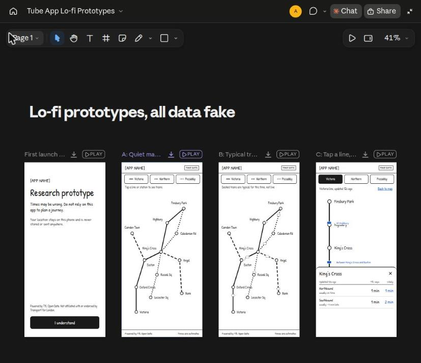
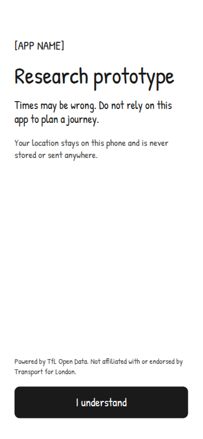
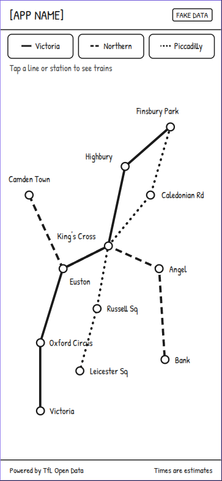
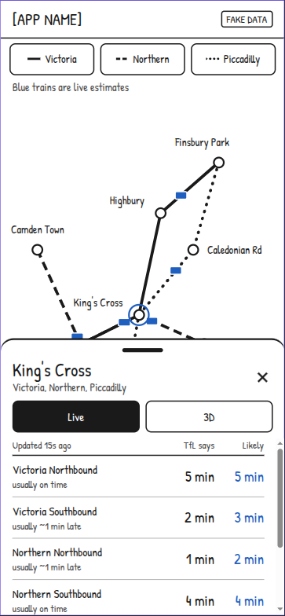
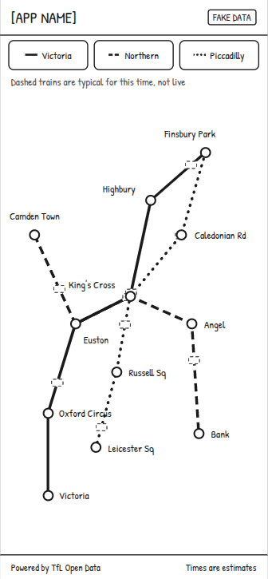
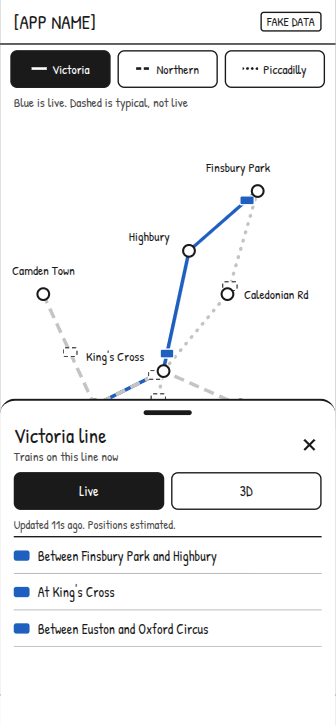
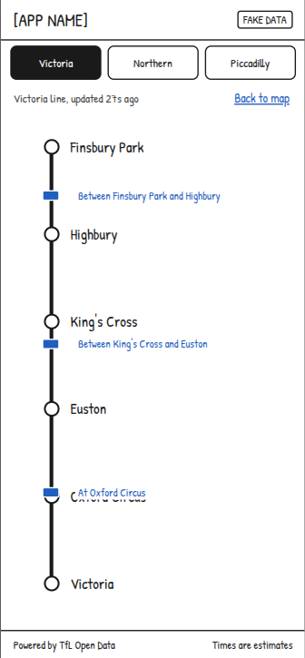
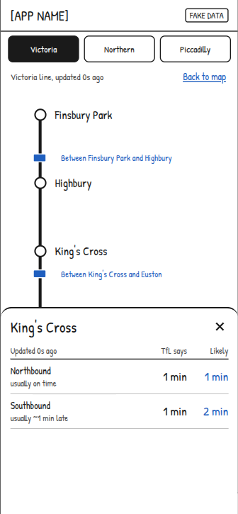

# Wireframes

Lo-fi sketch of the app concept (D-010). Fake data throughout.

**Source:** these sketches were generated by Claude Code (Claude Sonnet 5.5) on 2026-11-02 from my
description of the app, and I accepted them as good enough to work from. See `docs/ai-use-log.md`.

```
A. FIRST LAUNCH            B. MAP (main screen)         C. TAP A STATION
+------------------+       +------------------+         +------------------+
|                  |       | Live Tube      o |         | (map, dimmed)    |
|   Research       |       |                  |         |==================|
|   prototype      |       |  o----o----o     |         | ---              |
|                  |       |       \          |         | King's Cross     |
| Times may be     |       |  o--*->o----o    |         | Victoria line    |
| wrong. Do not    |       |        |         |         | [ Live | 3D ]    |
| rely on this to  |       |   o----*->o      |         |                  |
| plan a journey.  |       |        |         |         | Northbound       |
|                  |       |  * = train       |         |  TfL says  Likely|
| [  I understand ]|       |  (estimated)     |         |   3 min    4 min |
|                  |       |                  |         |  usually ~1 min  |
|                  |       | Powered by TfL   |         |  late            |
|                  |       | Open Data        |         |                  |
+------------------+       +------------------+         +------------------+

D. 3D VIEW (after tapping 3D; stretch goal, after 2D works)
+------------------+
| < King's Cross   |
|                  |
|  ====\           |
|       \====*->   |
|            \==   |
|  schematic only, |
|  not real depth  |
|  [ Live | 3D ]   |
+------------------+
```

## Flow
First launch warning, then the flat 2D map. Tapping a line or station makes the live data request
and opens a pull-up sheet with live arrivals. The 3D view is reached from the sheet.

## Clickable lo-fi prototypes
Three directions plus the first-launch screen, generated by Claude Code (Claude Opus 5.5) on
2026-11-02 at my request. Fake data throughout. These are throwaway design mock-ups hosted outside
this repo and are not project code; the app itself is written by me, by hand (D-007).

One thing i will mention is that the actual design is inspired from the TFL Go app itself with the 3d elements going to be designed myself, the screenshots for the prototype are in this subfolder /screenshots

Link: https://claude.ai/artifact/7CQy7iHB13etbT7NbCWkXR

- **A:** quiet map, trains appear only after a tap.
- **B:** dashed "typical" trains until a tap, then the selected line goes live.
- **C:** tapping a line turns the map into a straight strip with trains between stations.

## Screenshots
Captured on 2026-11-02 from the prototype page. All data is fake.



| First launch | A: map before a tap | A: station sheet |
|---|---|---|
|  |  |  |

| B: map before a tap | B: line sheet |
|---|---|
|  |  |

| C: line strip | C: station sheet |
|---|---|
|  |  |
